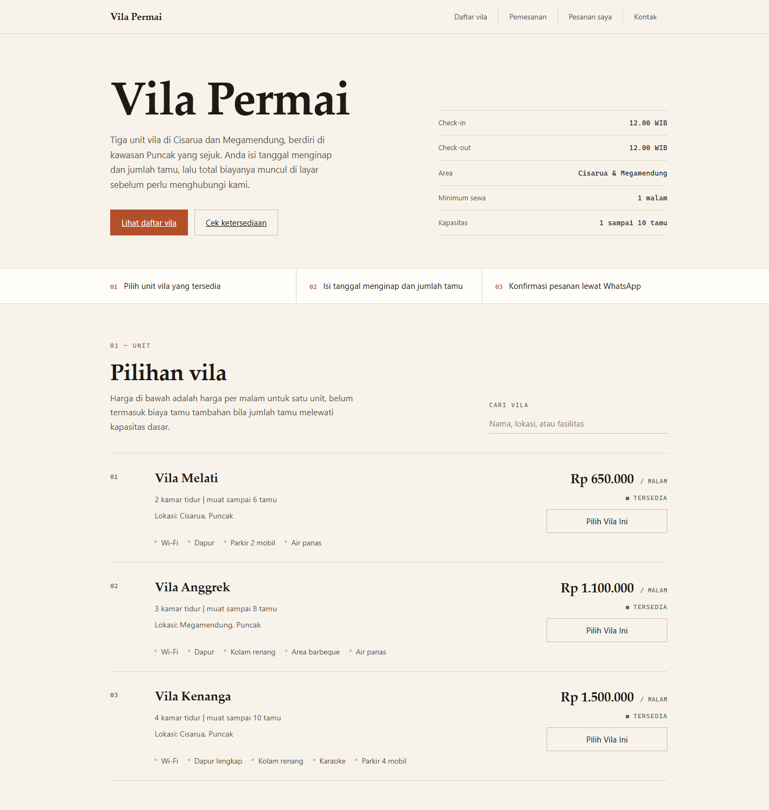
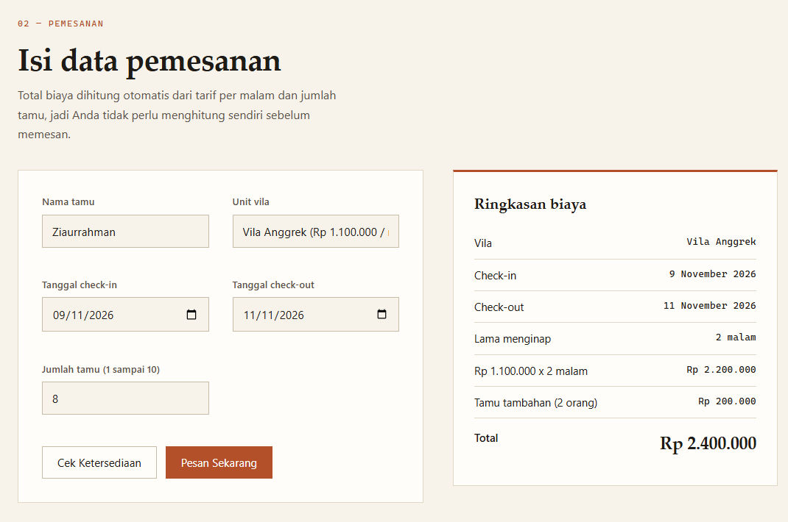

# Vila Permai

Nama : Ziaurrahman Athaya
NIM : 24011130461
Repository : uts-villa-permai-24011130461

## Tentang proyek

Halaman web pemesanan vila untuk usaha keluarga Pak Hendra di daerah Puncak, Bogor. Selama ini pemesanan lewat WhatsApp dan sering salah paham soal tanggal dan harga. Halaman ini dibuat supaya calon tamu bisa lihat daftar vila, memasukkan tanggal menginap, dan langsung tahu total biayanya tanpa harus tanya dulu.

Tidak ada server maupun database. Semua data vila ada di dalam `script.js` dalam bentuk array, dan pesanan disimpan di localStorage browser.

## Cara menjalankan

1. Download atau clone repository ini.
2. Buka folder `uts-villa-permai-24011130461`.
3. Klik dua kali `index.html` sampai terbuka di browser.

Tidak perlu install apa-apa. Halaman juga bisa dibuka langsung secara online lewat GitHub Pages pada alamat:

```
https://haru-kazumoto.github.io/uts-villa-permai-24011130461/
```

## Tampilan halaman





## Struktur file

```
uts-villa-permai-24011130461/
  .gitignore
  index.html
  style.css
  script.js
  README.md
  screenshot/
    halaman-utama.png
    halaman-pemesanan.png
```

## Cara hitung biaya

Total = (harga per malam + biaya tamu tambahan) x jumlah malam.

Tiap vila punya batas tamu dasar. Kalau jumlah tamu lebih dari batas itu, ada biaya tambahan per orang per malam. Sebagai contoh Vila Melati harganya Rp650.000 per malam untuk 4 tamu, lalu tiap tamu tambahan Rp50.000 per malam. Setiap vila maksimal bisa menampung 2 tamu di atas batas dasar.

## Fitur

Sudah selesai:

- [x] Daftar tiga vila yang dirender dari array di JavaScript
- [x] Pencarian vila (nama, lokasi, fasilitas)
- [x] Dropdown pilihan vila yang diisi otomatis dari data
- [x] Total biaya muncul otomatis saat tanggal/jumlah tamu berubah
- [x] Tombol Cek Ketersediaan
- [x] Validasi form dengan pesan bahasa Indonesia (nama kosong, check-out sebelum check-in, tanggal lampau, jumlah tamu di luar 1-10)
- [x] Deteksi tanggal bentrok untuk vila yang sama
- [x] Daftar pesanan dan nama terakhir disimpan di localStorage
- [x] Pembatalan pesanan
- [x] Tampilan responsif (breakpoint 980px, 768px, 640px, 560px, dan 480px)

Belum selesai / keterbatasan:

- [ ] Pesanan hanya tersimpan di browser masing-masing tamu. Jadi kalau dua orang berbeda memesan tanggal yang sama dari HP masing-masing, bentrok belum bisa terdeteksi. Untuk itu memang butuh server atau database.
- [ ] Belum ada foto vila
- [ ] Belum ada pembayaran online, konfirmasi masih lewat WhatsApp pemilik
- [ ] Nomor WhatsApp dan email di footer masih contoh, perlu diganti dengan data asli Pak Hendra

## Tema tampilan

Temanya editorial: latar kertas hangat, teks tinta, dan aksen terakota. Pemisahan antar bagian memakai garis rambut, bukan kotak dengan bayangan. Daftar vila ditampilkan sebagai baris tabel (nomor unit, nama, lokasi, harga, tombol) dan bukan kartu.

Semua warna, ukuran huruf, dan jarak disimpan sebagai variabel di bagian `:root` pada `style.css`, jadi tema bisa diganti dari satu tempat. Font memakai font bawaan sistem, jadi halaman tetap bisa dibuka tanpa koneksi internet.

## Pengembangan lanjutan

- Branch `fitur/filter` berisi tambahan filter kapasitas tamu dan pengurutan harga pada daftar vila. Branch ini belum digabung ke `main` supaya `main` tetap berisi versi yang dinilai.
- Tag `v1.0` menandai versi rilis pertama aplikasi.
- GitHub Pages dipakai untuk menyajikan halaman secara online.

## Mengubah data vila

Buka `script.js`, lalu edit array `daftarVila` di bagian paling atas. Harga, fasilitas, dan status ketersediaan (`tersedia: true/false`) bisa diubah dari situ.
